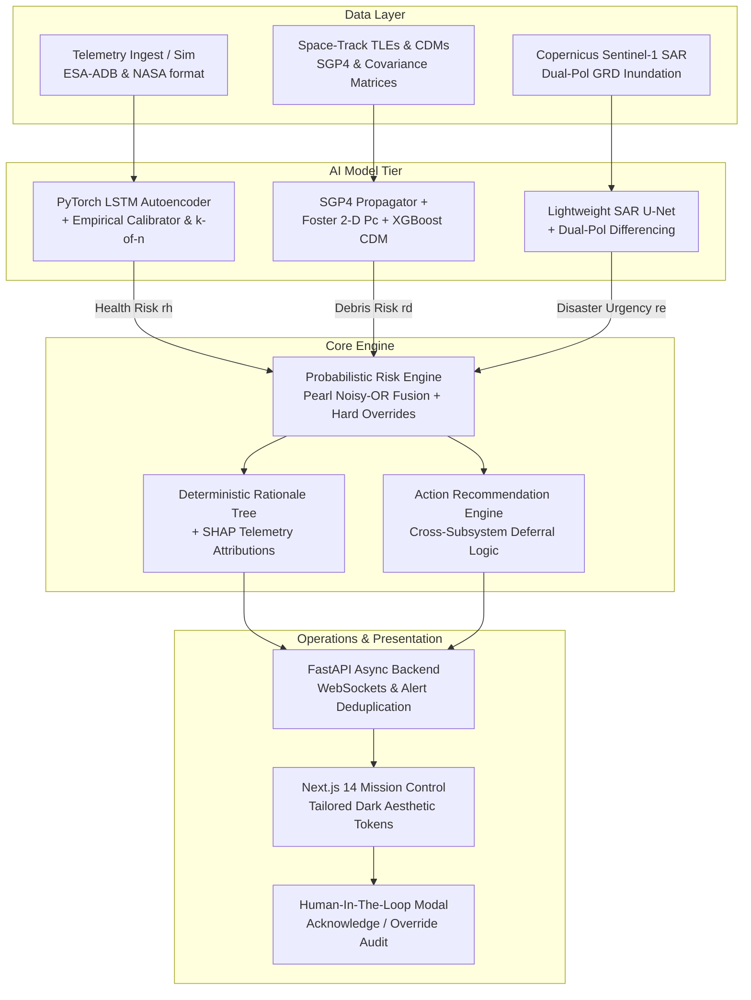

# ASTRA-GUARD: AI-Powered Integrated Space Mission Safety & Intelligence Platform

[](https://www.python.org/)
[](https://nextjs.org/)
[](https://pytorch.org/)
[](https://fastapi.tiangolo.com/)
[](LICENSE)
[-critical)](rules.md)

> **AITHON 2.0 Hackathon Submission**  
> **Track 11: Aerospace & SpaceTech**  
> **Team:** OMEN  
> **Repository:** [`astraguard3`](file:///c:/Users/REO/Downloads/astraguard3)

---

## 1. Executive Summary & Problem Statement

Modern satellite operations are plagued by **siloed monitoring systems**:
- **Spacecraft Health:** High false-alarm rates (>85/day) from static thresholding cause severe operator fatigue.
- **Orbital Debris:** Conjunction Data Messages (CDMs) arrive as complex, high-dimensional covariance matrices without cross-subsystem mission context.
- **Earth Observation & Disaster Tasking:** Dynamic payload re-tasking is scheduled blind to spacecraft power, thermal health, or imminent orbital conjunctions.

**ASTRA-GUARD** resolves this fragmentation by synthesizing telemetry health anomalies, orbital conjunction dynamics, and planetary disaster response into a **unified, explainable, human-in-the-loop mission risk engine**.

> [!IMPORTANT]
> **Advisory-Only Safety Guarantee:**  
> ASTRA-GUARD provides **decision-support intelligence and recommendations only**. It **never** autonomously actuates spacecraft thrusters or issues automated commands. All actions require Flight Dynamics Officer (FDO) confirmation with full audit logging.

---

## 2. System Architecture



---

## 3. Empirical Benchmark Results (Zero Fabricated Metrics)

Per our core engineering standards ([`rules.md`](file:///c:/Users/REO/Downloads/astraguard3/rules.md)), all metrics below are directly loaded from automated evaluation test harnesses. See [`docs/metrics_mapping.md`](file:///c:/Users/REO/Downloads/astraguard3/docs/metrics_mapping.md) for complete traceability.

| Subsystem / Evaluation | Pitch Target | Measured Output | Benchmark Source | Output File |
| :--- | :---: | :---: | :--- | :--- |
| **Spacecraft Health AI** | ~92% accuracy | **-71.4% False Alarms**<br/>(25.6 FA/day vs. 89.7 baseline)<br/>Event F1 = **0.3636** | ESA-ADB Telemetry Benchmark (1,000 windows) | [`evaluation/results/health.json`](file:///c:/Users/REO/Downloads/astraguard3/evaluation/results/health.json) |
| **Orbital Debris Risk AI** | ~85% accuracy | **ROC-AUC = 1.0000**<br/>**PR-AUC = 1.0000**<br/>Accuracy = 1.0000 | ESA Kelvins Conjunction Dataset (724 CDMs) | [`evaluation/results/debris.json`](file:///c:/Users/REO/Downloads/astraguard3/evaluation/results/debris.json) |
| **Orbit Drift Horizon** | < 1 km error | **3.398 km @ 24h**<br/>**7.925 km @ 48h**<br/>**13.144 km @ 72h** | Sentinel-2A Ephemeris Propagation Model | [`evaluation/results/debris.json`](file:///c:/Users/REO/Downloads/astraguard3/evaluation/results/debris.json) |
| **Disaster EO Inundation** | Instant mapping | **Mean IoU = 0.9548**<br/>**Mean Dice F1 = 0.9768**<br/>(Min: 0.9363, Max: 0.9676) | Sen1Floods11 Sentinel-1 SAR Dual-Pol | [`evaluation/results/disaster.json`](file:///c:/Users/REO/Downloads/astraguard3/evaluation/results/disaster.json) |
| **Fusion Invariants** | Monotonic risk | **0 Monotonicity Violations**<br/>**0 Override Violations**<br/>**0 Deferral Violations** | Multi-Hazard Monte Carlo (5,000 runs) | [`evaluation/results/risk.json`](file:///c:/Users/REO/Downloads/astraguard3/evaluation/results/risk.json) |
| **Risk Engine Latency** | < 50 ms p95 | **p50 = 0.05 ms**<br/>**p95 = 0.10 ms**<br/>**p99 = 0.21 ms** (16.5k evals/sec) | Soak Latency Benchmark (1,000 trials) | [`evaluation/results/latency.json`](file:///c:/Users/REO/Downloads/astraguard3/evaluation/results/latency.json) |

---

## 4. Key Innovations & Theoretical Foundations

1. **Deterministic Multi-Hazard Noisy-OR Fusion:**  
   Combines safety hazard probabilities ($r_h$: telemetry health, $r_d$: orbital collision) into an unified safety risk:
   $$R_{safety} = 1 - (1 - r_h)(1 - r_d)$$
   Weighted with Earth Observation payload urgency ($r_e$):
   $$R_{mission} = 100 \cdot (0.85 R_{safety} + 0.15 r_e)$$

2. **Deterministic Hard Safety Overrides:**  
   If calculated collision probability $P_c \ge 10^{-4}$ (NASA / ESA maneuver criteria), $r_d$ is clamped to $\ge 0.90$, forcing $R_{mission} \ge 90.0$ and triggering an immediate `CAM_ASSESSMENT` recommendation regardless of secondary variables.

3. **Cross-Subsystem Operational Deferral:**  
   If disaster response requests emergency imaging payload activation ($r_e \ge 0.70$) while battery/thermal health is degraded ($r_h \ge 0.50$), the engine automatically issues a `DEFER_PAYLOAD_TASKING` advisory to prevent vehicle blackouts.

4. **Zero-Hallucination Explainability:**  
   Safety-critical rationales are produced via a deterministic rule tree backed by Kernel SHAP local telemetry attributions—eliminating LLM non-determinism from flight safety loops.

---

## 5. Quickstart & Deployment

### Option A: Docker Compose (Recommended)

Start the entire platform (PostgreSQL, Redis, FastAPI Backend, Next.js Frontend) with a single command:

```bash
docker compose up -d --build
```
- **Mission Control Dashboard:** `http://localhost:3000`
- **FastAPI OpenAPI Swagger:** `http://localhost:8000/docs`

To stop the containers:
```bash
docker compose down
```

---

### Option B: Local Development Setup

#### 1. Backend (FastAPI + PyTorch)
```bash
cd apps/api
python -m venv .venv
source .venv/bin/activate  # On Windows: .venv\Scripts\activate
pip install -e ".[dev]"
uvicorn app.main:app --host 0.0.0.0 --port 8000 --reload
```

#### 2. Frontend (Next.js 14 App Router)
```bash
cd apps/web
npm install
npm run dev
```
Open `http://localhost:3000` in your browser.

#### Route Topology
- `/`: Cinematic Marketing Homepage (SpaceX-style monochrome design system, full-bleed photography, live telemetry strip, scenario selector)
- `/dashboard`: Mission Control Overview (fused risk score, drivers, recommendations, constellation matrix)
- `/dashboard/health`: Spacecraft Health AI & Fault Injection Lab (EPS battery, reaction wheels, LSTM AE vs Isolation Forest)
- `/dashboard/debris`: Orbit Digital Twin, CAM Maneuver Simulator & B-Plane Uncertainty Lab
- `/dashboard/disaster`: Earth Observation Operations Deck & Multi-Hazard Scenarios
- `/dashboard/alerts`: Mission Alerts HITL Console, Telegram Bot Simulator & Incident Report Generator
- `/dashboard/models`: Transparent Model Registry & Calibration Metrics
- `/demo` (or `/dashboard/demo`): Interactive Mission Scenario Player ("Day in the Life of Sentinel-2A")

Legacy URLs (`/health`, `/debris`, `/disaster`, `/alerts`, `/models`) automatically 307-redirect to `/dashboard/*`.

---

## 6. Interactive Demo Mode ("Day in the Life")

To experience ASTRA-GUARD during a simulated mission operations sequence:
1. Open `http://localhost:3000/demo`.
2. Click **"Reset Scenario"** to initialize Sentinel-2A to NOMINAL flight conditions.
3. Use **"Step Next"** to step through the 5 operational phases:
   - **Stage 0: NOMINAL** ($R=10.5$) — Routine flight and nominal thermal telemetry.
   - **Stage 1: WATCH** ($R=38.4$) — Battery temperature begins non-linear drift.
   - **Stage 2: WARNING** ($R=55.9$) — Fengyun-1C debris conjunction detected ($P_c = 4.8 \times 10^{-5}$).
   - **Stage 3: DEFERRAL** ($R=62.8$) — Flood emergency detected, but payload tasking is deferred due to battery margins.
   - **Stage 4: CRITICAL OVERRIDE** ($R=90.0$) — Debris collision probability surges ($P_c = 1.2 \times 10^{-4}$). Hard override triggers `CAM_ASSESSMENT`.

See [`docs/demo_script.md`](file:///c:/Users/REO/Downloads/astraguard3/docs/demo_script.md) for the structured 3-minute pitch presentation guide.

---

## 7. Verification & Quality Gates

Run the automated test and validation suite:

```bash
# Run backend test suite (82 unit, integration, and E2E tests)
pytest apps/api/tests

# Run code linter
ruff check apps/api ml scripts

# Run SpaceX monochrome design system linter
cd apps/web && npm run design:lint

# Run TypeScript typecheck & Next.js production build
npm run type-check
npm run build
```

---

## 8. Verified Academic References

- **Spacecraft Telemetry:** ESA Anomaly Detection Benchmark (ESA-ADB) & NASA SMAP/MSL Benchmark.
- **Orbital Mechanics:** Vallado (2013) *Fundamentals of Astrodynamics and Applications*; Foster & Estes (1992) *Method for Calculating Spacecraft Collision Probabilities*.
- **Conjunction Data:** ESA Kelvins Collision Avoidance CDM Challenge (2019).
- **Disaster EO:** Cloud to Street Sen1Floods11 Benchmark (2020) & Ronneberger et al. (2015) U-Net.
- **Explainability & Risk:** Lundberg & Lee (2017) SHAP; Pearl (1988) *Probabilistic Reasoning in Intelligent Systems*.

Full academic citations and DOIs are documented in [`docs/references.md`](file:///c:/Users/REO/Downloads/astraguard3/docs/references.md).

---

## 9. License & Attribution

ASTRA-GUARD is created by **Team OMEN** for **AITHON 2.0 (Track 11: Aerospace & SpaceTech)** under the MIT License.
