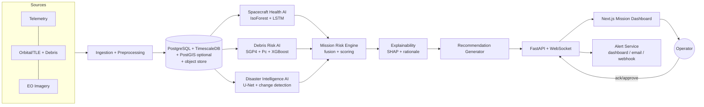

# Architecture — ASTRA-GUARD

## 1. Style
Modular monolith (FastAPI) + background workers + Next.js dashboard. Each AI domain is an isolated Python package behind a common interface so it can be swapped or scaled out later.

## 2. High-Level Flow


## 3. Stack Decision (resolves deck conflict)
| Layer | Choice | Why |
|---|---|---|
| Frontend | Next.js (React, TS), Tailwind, Recharts, react-globe.gl (three.js) | Matches slide text; rich viz |
| Backend | FastAPI (Python 3.11), Pydantic v2, SQLAlchemy 2, Alembic | ML is Python-native |
| Realtime | WebSocket (FastAPI) / SSE fallback | Live alert feed |
| Jobs | APScheduler or Celery+Redis (start with APScheduler) | Keep MVP simple |
| DB | PostgreSQL 16 + TimescaleDB (SQLite allowed for dev) | Time-series + relational |
| ML | scikit-learn, XGBoost, PyTorch, SHAP, sgp4/skyfield, rasterio, numpy, pandas | As per deck |
| Packaging | Docker, docker compose, GitHub Actions | |
| Deploy | Frontend → Vercel; backend → Docker on any VM/Render/Railway; NGINX reverse proxy | Per deck |
| Mobile | **Deferred** (React Native/Expo in Future Work) | Scope control |

## 4. Repository Layout
```
astra-guard/
├─ apps/
│  ├─ web/                    # Next.js dashboard
│  └─ api/
│     ├─ app/
│     │  ├─ main.py
│     │  ├─ core/             # config, logging, security
│     │  ├─ db/               # models, session, migrations
│     │  ├─ schemas/          # Pydantic DTOs
│     │  ├─ routers/          # telemetry, orbits, imagery, risk, alerts, demo
│     │  ├─ services/         # ingestion, alerting, scheduler
│     │  └─ ws/               # websocket manager
│     └─ tests/
├─ ml/
│  ├─ common/                 # interfaces, metrics, io
│  ├─ health/                 # preprocess, iforest, lstm, explain
│  ├─ debris/                 # propagate, screen, pc, risk_model
│  ├─ disaster/               # unet, change_detect, priority
│  ├─ risk_engine/            # fuse, explain, recommend
│  └─ evaluation/             # reports → /evaluation/results/*.json
├─ data/                      # raw/ (gitignored), samples/, synthetic/
├─ scenarios/                 # demo scenario definitions (YAML/JSON)
├─ notebooks/
├─ infra/                     # docker, nginx, compose
├─ docs/                      # prd.md architecture.md rules.md phases.md design.md memory.md
└─ .github/workflows/
```

## 5. Module Contracts
Every AI module implements:
```python
class RiskModule(Protocol):
    name: str
    version: str
    def fit(self, data) -> None: ...
    def score(self, window) -> ModuleResult: ...
    def explain(self, window, result) -> list[Attribution]: ...

class ModuleResult(BaseModel):
    score: float          # 0..1 normalized risk
    confidence: float     # 0..1
    evidence: dict        # module-specific details
    ts: datetime
    asset_id: str
```

### 5.1 Spacecraft Health AI
- **Preprocess:** resample to fixed Δt, per-channel robust scaling (fit on nominal only), sliding windows (e.g., 64–256 steps), forward-fill with gap flags.
- **Models:** Isolation Forest on engineered features (mean/std/slope/FFT bands per window) = baseline; LSTM autoencoder (or forecaster) on windows, anomaly = reconstruction/forecast residual.
- **Score:** calibrated to 0–1 using percentile of nominal residuals; persistence filter (k of n windows) to cut false alerts.
- **Explain:** SHAP `TreeExplainer` for IsoForest features; per-channel residual contribution for LSTM; top-k channels returned.

### 5.2 Debris Collision Risk AI
1. Fetch GP/TLE (CelesTrak) → cache.
2. Propagate primary + catalog with **SGP4** over horizon (default 72 h, step 30–60 s).
3. **Screen:** coarse filter (altitude band/perigee-apogee overlap) → KD-tree on sampled positions → refine TCA via root-finding on range-rate.
4. **Pc:** 2-D Foster/Chan integration with assumed covariance (labelled *screening-grade*, since TLEs carry none). Where CDMs are available (Kelvins), use real covariances.
5. **ML trend model:** XGBoost (tabular CDM features) and/or LSTM (CDM time series) predicts final-CDM risk class; evaluated on Kelvins.
6. **Score:** map log10(Pc) to 0–1 (e.g., 1e-7→0, 1e-4→0.9, ≥1e-3→1.0) blended with miss distance & time-to-TCA.

### 5.3 Disaster Intelligence AI
- **Input:** Sentinel-2 / Sentinel-1 tiles (or pre-chipped samples).
- **Models:** U-Net (flood, fire burn scar) fine-tuned on Sen1Floods11; xBD for damage; change detection via siamese U-Net or simple differencing as fallback.
- **Output:** mask GeoTIFF/PNG overlay, affected-area km², confidence.
- **Observation Priority Score:** `0.4·area_norm + 0.25·recency + 0.2·pop_proxy + 0.15·(1 − cloud_cover)`, penalized by revisit gap and satellite health state.

### 5.4 Mission Risk Engine
Inputs: `r_h` (health), `r_d` (debris), `r_e` (EO priority), each 0–1 with confidence.
```
R_safety  = 1 − (1 − r_h)(1 − r_d)            # noisy-OR: either hazard raises risk
R_mission = 100 · (0.85·R_safety + 0.15·r_e)  # EO priority adds, never dominates
Hard overrides: Pc ≥ 1e-4  → level ≥ CRITICAL
                r_h ≥ 0.9 persistent → level ≥ WARNING
Levels: 0–25 NOMINAL · 25–50 WATCH · 50–75 WARNING · 75–100 CRITICAL
Cross-effects: if r_h ≥ 0.5 → EO tasks flagged "defer/low-power".
```
Weights live in `config/risk_engine.yaml`; tuned on scenarios, not hard-coded.

### 5.5 Explainability & Recommendations
- Attribution list: `[{driver, module, contribution, direction}]` (module-level contributions from fusion terms + SHAP/channel-level from sub-models).
- NL rationale from templates (deterministic; **no free-form LLM in safety path**). Optional LLM "summarize" button, clearly marked non-authoritative.
- Recommendation rules (examples): Pc trend rising & TCA < 24 h → "Prepare conjunction assessment / maneuver analysis"; thermal drift → "Review subsystem X, reduce load"; flood detected + healthy → "Task imaging over region R".
- Every recommendation requires `operator_action ∈ {approve, dismiss, snooze}` and is logged.

## 6. Data Model (core tables)
| Table | Key columns |
|---|---|
| `assets` | id, name, norad_id, type, tle_epoch |
| `telemetry` (hypertable) | asset_id, ts, channel, value, quality |
| `telemetry_windows` | id, asset_id, t_start, t_end, score, model_ver |
| `objects` | norad_id, name, type (debris/payload), tle_line1/2, epoch |
| `conjunctions` | id, primary_id, secondary_id, tca, miss_km, rel_vel_kms, pc, pc_method, risk_class |
| `imagery_products` | id, source, bbox, acquired_at, cloud_pct, uri |
| `disaster_events` | id, product_id, type, area_km2, mask_uri, priority, confidence |
| `risk_snapshots` | id, asset_id, ts, r_h, r_d, r_e, score, level, drivers(JSONB) |
| `alerts` | id, snapshot_id, level, title, rationale, recommendation, status, dedup_key |
| `operator_actions` | id, alert_id, user, action, note, ts |
| `model_registry` | name, version, metrics(JSONB), trained_at, data_hash |

## 7. API (REST + WS)
```
GET  /api/v1/assets
GET  /api/v1/assets/{id}/health?from=&to=
GET  /api/v1/assets/{id}/conjunctions?min_pc=
GET  /api/v1/events/disasters?bbox=
GET  /api/v1/risk/{asset_id}/latest   | /history
GET  /api/v1/alerts?status=           | POST /alerts/{id}/action
POST /api/v1/ingest/telemetry         | /ingest/tle | /ingest/imagery
POST /api/v1/demo/start  /pause  /seek  /reset   (Demo Mode)
GET  /api/v1/models                   (versions + metrics)
WS   /ws/alerts   /ws/risk/{asset_id}
GET  /healthz
```

## 8. Alerting
Dedup by `(asset, driver, level)`; cooldown window; escalate only on level increase; channels: dashboard WS (P0), email SMTP/webhook (P1), SMS provider (P2).

## 9. Demo Mode
`scenarios/*.yaml` define timeline events + seeded data. A **ScenarioPlayer** emits data into the same ingestion path as live feeds (no special-case code), so the demo exercises the real pipeline. Controls: play/pause/seek/speed.

## 10. Evaluation Harness (`ml/evaluation`)
Produces JSON + markdown reports consumed by the dashboard "Models" page and slides:
- Health: event-wise precision/recall/F0.5 & F1, point-adjusted metrics noted separately, false alarms/day.
- Debris: ROC-AUC/PR-AUC on Kelvins, SGP4 position error vs. reference ephemeris by horizon.
- Disaster: IoU/F1 on held-out Sen1Floods11.
- System: end-to-end latency p50/p95.

## 11. Security & Ops
Env-based secrets (`.env`, never committed), CORS allow-list, input validation (Pydantic), rate limiting, optional API-key/JWT for write routes, structured JSON logs, request IDs, `/healthz`. NGINX in front; HTTPS in deploy.

## 12. Deployment
`docker compose`: `web`, `api`, `worker`, `db`, `nginx` (+`redis` if Celery). CI: lint (ruff, eslint), type-check (mypy, tsc), tests (pytest, vitest), build images.