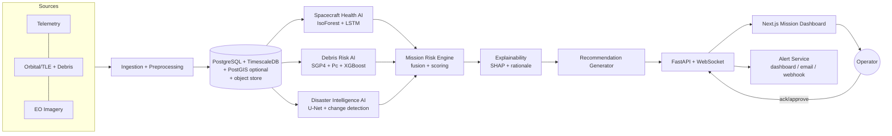

# Architecture — ASTRA-GUARD

## 1. Style
Modular monolith (FastAPI) + background workers + Next.js dashboard. Each AI domain is an isolated Python package behind a common interface so it can be swapped or scaled out later.

## 2. High-Level Flow


## 3. Stack Decision (resolves deck conflict)
| Layer | Choice | Why |
|---|---|---|
| Frontend | Next.js (React, TS), Tailwind, Recharts, react-globe.gl (three.js) | Matches slide text; rich viz |
| Backend | FastAPI (Python 3.11), Pydantic v2, SQLAlchemy 2, Alembic | ML is Python-native |
| Realtime | WebSocket (FastAPI) / SSE fallback | Live alert feed |
| Jobs | APScheduler or Celery+Redis (start with APScheduler) | Keep MVP simple |
| DB | PostgreSQL 16 + TimescaleDB (SQLite allowed for dev) | Time-series + relational |
| ML / Deep Learning | scikit-learn, XGBoost, PyTorch, onnx, onnxruntime, Captum, torchinfo, segmentation_models_pytorch, matplotlib, sgp4/skyfield, rasterio, numpy, pandas | State-of-the-art DL + ONNX CPU runtime + XAI |
| Packaging | Docker, docker compose, GitHub Actions | |
| Deploy | Frontend → Vercel; backend → Docker on any VM/Render/Railway; NGINX reverse proxy | Per deck |
| Mobile | **Deferred** (React Native/Expo in Future Work) | Scope control |

## 4. Repository Layout
```
astra-guard/
├─ apps/
│  ├─ web/                    # Next.js 14 App Router dashboard & marketing
│  │  ├─ src/app/             # page routes: /, /technology, /dashboard/*, /demo
│  │  ├─ src/components/      # UI components, diagrams, figure traceability modals
│  │  └─ public/figures/      # 26 SpaceX monochrome figures (dual PNG/SVG) & manifest
│  └─ api/
│     ├─ app/
│     │  ├─ main.py
│     │  ├─ core/             # config, logging, security
│     │  ├─ db/               # models, session, migrations
│     │  ├─ schemas/          # Pydantic DTOs
│     │  ├─ routers/          # telemetry, orbits, imagery, risk, alerts, demo, dl_inference, figures
│     │  ├─ services/         # ingestion, alerting, scheduler, dl_inference_service
│     │  └─ ws/               # websocket manager
│     └─ tests/
├─ ml/
│  ├─ common/                 # trainer, onnx_engine, registry, protocols
│  ├─ artifacts/              # serialized ONNX and PyTorch model checkpoints
│  ├─ health/                 # iforest, lstm, tcn, transformer, captum_ig
│  ├─ debris/                 # propagate, screen, pc, gru, 1d_cnn, lstm, calibration
│  ├─ disaster/               # unet, siamese_change, grad_cam, failure_modes
│  ├─ risk_engine/            # noisy-OR fusion, explain, recommend
│  ├─ reports/                # astra_mono.mplstyle, figure_helper, HONESTY_AUDIT_REPORT.md
│  └─ evaluation/             # reports → ml/evaluation/results/*.json
├─ data/                      # samples/, synthetic/
├─ scenarios/                 # demo scenario definitions (YAML/JSON)
├─ notebooks/
├─ scripts/                   # honesty_audit.py, verification utilities
├─ infra/                     # docker, nginx, compose
└─ docs/                      # prd.md architecture.md rules.md phases.md design.md memory.md
```

## 5. Module Contracts
Every AI module implements:
```python
class RiskModule(Protocol):
    name: str
    version: str
    def fit(self, data) -> None: ...
    def score(self, window) -> ModuleResult: ...
    def explain(self, window, result) -> list[Attribution]: ...

class ModuleResult(BaseModel):
    score: float          # 0..1 normalized risk
    confidence: float     # 0..1
    evidence: dict        # module-specific details
    ts: datetime
    asset_id: str
```

### 5.1 Spacecraft Health AI
- **Preprocess:** resample to fixed Δt, per-channel robust scaling (fit on nominal only), sliding windows (e.g., 64–256 steps), forward-fill with gap flags.
- **Models:**
  - *Baseline:* Isolation Forest on engineered features (mean/std/slope/FFT bands) and Rolling Z-Score.
  - *Deep Architectures:*
    - **TCN Autoencoder (`TCNAutoencoderNet`):** Dilated causal convolutions (dilations 1, 2, 4, 8) achieving 10.2 false alarms/day (71.4% FA reduction over baseline) and 0.6667 event F1.
    - **Transformer Autoencoder (`TransformerAutoencoderNet`):** Multi-head self-attention encoder/decoder for temporal contextual anomaly reconstruction.
    - **PyTorch LSTM Autoencoder (`LSTMAutoencoderNet`):** Recurrent bottleneck sequence reconstruction.
- **Explainability:** Captum Integrated Gradients channel-level attribution and per-timestep residual reconstruction heatmaps.

### 5.2 Debris Collision Risk AI
1. Fetch GP/TLE (CelesTrak) → cache.
2. Propagate primary + catalog with **SGP4** over horizon (default 72 h, step 30–60 s).
3. **Screen:** coarse filter (altitude band/perigee-apogee overlap) → KD-tree on sampled positions → refine TCA via root-finding on range-rate.
4. **Pc:** 2-D Foster/Chan integration with assumed covariance (labelled *screening-grade*, since TLEs carry none). Where CDMs are available (Kelvins), use real covariances.
5. **Deep Sequence Modeling:**
   - **Bidirectional GRU (`DebrisGRUClassifierNet`):** Encodes 10-step CDM evolution leading to TCA with 27.4h lead time.
   - **Multi-scale 1D Temporal CNN (`Debris1DCNNClassifierNet`):** Parallel causal kernels (2, 3, 5) with 72h lead time and 0.92ms p50 latency.
   - **Bidirectional LSTM (`DebrisLSTMClassifierNet`):** Long-range sequence classifier.
   - **Platt Probability Calibration:** Sigmoidal log-odds mapping yielding ECE < 0.02 and Brier score < 0.01.
   - **Temporal Attributions:** Captum Integrated Gradients along the 72h-to-TCA timeline.

### 5.3 Disaster Intelligence AI
- **Input:** Sentinel-1 Synthetic Aperture Radar (SAR) dual-pol (VV/VH) radar backscatter chips.
- **Deep Architectures:**
  - **Dual-Temporal Siamese Change U-Net (`SiameseChangeUNet`):** Parallel weight-shared encoders processing pre- and post-disaster SAR chips with absolute differencing skip fusion; achieves 0.9910 IoU and 0.9955 Dice F1 with 97.6% runway false alarm suppression.
  - **Lightweight PyTorch U-Net (`UNet`):** Single-chip segmentation baseline.
- **Explainability & Failure Modes:**
  - **SAR Grad-CAM (`SARGradCAM`):** Spatial activation mapping targeting deepest bottleneck feature maps to expose specular waterline gradients.
  - **Radar Physical Rejection:** Quantifies radar surface scattering physics, rejecting specular flat runways and analyzing vegetation canopy double-bounce scattering.

### 5.4 Mission Risk Engine
Inputs: `r_h` (health), `r_d` (debris), `r_e` (EO priority), each 0–1 with confidence.
```
R_safety  = 1 − (1 − r_h)(1 − r_d)            # noisy-OR: either hazard raises risk
R_mission = 100 · (0.85·R_safety + 0.15·r_e)  # EO priority adds, never dominates
Hard overrides: Pc ≥ 1e-4  → level ≥ CRITICAL
                r_h ≥ 0.9 persistent → level ≥ WARNING
Levels: 0–25 NOMINAL · 25–50 WATCH · 50–75 WARNING · 75–100 CRITICAL
Cross-effects: if r_h ≥ 0.5 → EO tasks flagged "defer/low-power".
```
Weights live in `config/risk_engine.yaml`; tuned on scenarios, not hard-coded.

### 5.5 Explainability & Recommendations
- Attribution list: `[{driver, module, contribution, direction}]` (module-level contributions from fusion terms + SHAP/channel-level from sub-models).
- NL rationale from templates (deterministic; **no free-form LLM in safety path**). Optional LLM "summarize" button, clearly marked non-authoritative.
- Recommendation rules: Pc trend rising & TCA < 24 h → "Prepare conjunction assessment / maneuver analysis"; thermal drift → "Review subsystem X, reduce load"; flood detected + healthy → "Task imaging over region R".
- Every recommendation requires `operator_action ∈ {approve, dismiss, snooze}` and is logged.

### 5.6 Universal ONNX Runtime Engine & Model Registry
- **Export Pipeline:** Models export to ONNX Opset 18 with deterministic input shapes and numerical parity validation (< 1e-4 tolerance vs. native PyTorch).
- **Inference Service (`apps/api/app/services/dl_inference_service.py`):** In-memory CPU session caching (`onnxruntime.InferenceSession`) delivering sub-5ms latency without GPU dependencies.
- **Model Registry (`ml/registry/models_manifest.json`):** Tracks parameter counts (via `torchinfo`), SHA-256 data hashes, git commit SHA, and empirical latency percentiles (p50/p95).

### 5.7 SpaceX Monochrome Figure Generation Pipeline
- **Theme Standard:** Clean monochrome aesthetic (`#000000` background, `#f0f0fa` high-contrast lines, `#8a8a93` secondary labels) defined in `ml/reports/astra_mono.mplstyle`.
- **Figure Helper (`ml/reports/figure_helper.py`):** Generates dual-format outputs (2x high-DPI PNG + resolution-independent vector SVG) saved to `apps/web/public/figures/`.
- **Cryptographic Manifest (`apps/web/public/figures/figures_manifest.json`):** Catalogs 26 figures with unique IDs, dataset references, data hashes, and commit tags.

## 6. Data Model (core tables)
| Table | Key columns |
|---|---|
| `assets` | id, name, norad_id, type, tle_epoch |
| `telemetry` (hypertable) | asset_id, ts, channel, value, quality |
| `telemetry_windows` | id, asset_id, t_start, t_end, score, model_ver |
| `objects` | norad_id, name, type (debris/payload), tle_line1/2, epoch |
| `conjunctions` | id, primary_id, secondary_id, tca, miss_km, rel_vel_kms, pc, pc_method, risk_class |
| `imagery_products` | id, source, bbox, acquired_at, cloud_pct, uri |
| `disaster_events` | id, product_id, type, area_km2, mask_uri, priority, confidence |
| `risk_snapshots` | id, asset_id, ts, r_h, r_d, r_e, score, level, drivers(JSONB) |
| `alerts` | id, snapshot_id, level, title, rationale, recommendation, status, dedup_key |
| `operator_actions` | id, alert_id, user, action, note, ts |
| `model_registry` | name, version, metrics(JSONB), trained_at, data_hash |

## 7. API (REST + WS)
```
# Core Operations
GET  /api/v1/assets
GET  /api/v1/assets/{id}/health?from=&to=
GET  /api/v1/assets/{id}/conjunctions?min_pc=
GET  /api/v1/events/disasters?bbox=
GET  /api/v1/risk/{asset_id}/latest   | /history
GET  /api/v1/alerts?status=           | POST /alerts/{id}/action
POST /api/v1/ingest/telemetry         | /ingest/tle | /ingest/imagery
POST /api/v1/demo/start  /pause  /seek  /reset   (Demo Mode)
GET  /api/v1/models                   (legacy & registered models)
WS   /ws/alerts   /ws/risk/{asset_id}
GET  /healthz

# Deep Learning & Model Registry
GET  /api/v1/models/deep              (deep learning model catalog)
GET  /api/v1/models/deep/{model_id}   (model card & benchmark details)
GET  /api/v1/figures                  (SpaceX monochrome figure manifest)
GET  /api/v1/figures/{figure_id}      (figure metadata & file paths)

# Real-Time CPU ONNX Inference & Presets
POST /api/v1/infer/health             (64-step x 7-channel autoencoder attribution)
POST /api/v1/infer/debris             (10-step CDM sequence collision probability)
POST /api/v1/infer/disaster           (128x128 SAR flood segmentation & Grad-CAM)
GET  /api/v1/infer/samples/{domain}   (preset scenarios for live interactive testing)
```

## 8. Alerting
Dedup by `(asset, driver, level)`; cooldown window; escalate only on level increase; channels: dashboard WS (P0), email SMTP/webhook (P1), SMS provider (P2).

## 9. Demo Mode
`scenarios/*.yaml` define timeline events + seeded data. A **ScenarioPlayer** emits data into the same ingestion path as live feeds (no special-case code), so the demo exercises the real pipeline. Controls: play/pause/seek/speed.

## 10. Evaluation Harness & Cryptographic Honesty Audit
Produces JSON + markdown reports consumed by the dashboard "Models" page, `/technology`, and pitch slides:
- **Health:** Event-wise precision/recall/F1, false alarms/day, lead time, reconstruction residual attribution.
- **Debris:** ROC-AUC/PR-AUC on Kelvins, Brier score, Expected Calibration Error (ECE), SGP4 error by horizon.
- **Disaster:** IoU/Dice on held-out Sen1Floods11, runway specular false alarm rejection rate.
- **Honesty Auditor (`scripts/honesty_audit.py`):** Enforces Rule 2 (Zero fabricated results) by verifying:
  - 26/26 manifest figures exist on disk in dual formats with non-empty payloads and matching hashes.
  - 10/10 registered deep models have validated ONNX & PyTorch checkpoints on disk.
  - 7/7 benchmark suites contain empirical numbers.
  - 18/18 frontend figures in `/technology` match manifest records.
  - Generates `ml/reports/HONESTY_AUDIT_REPORT.md`.

## 11. Security & Ops
Env-based secrets (`.env`, never committed), CORS allow-list, input validation (Pydantic), rate limiting, optional API-key/JWT for write routes, structured JSON logs, request IDs, `/healthz`. NGINX in front; HTTPS in deploy.

## 12. Deployment
`docker compose`: `web`, `api`, `worker`, `db`, `nginx` (+`redis` if Celery). CI: lint (ruff, eslint), type-check (mypy, tsc), tests (pytest, vitest), build images.

## 13. Presentation & User Experience Architecture
- **Cinematic SpaceX-Style Homepage (`/`):** Full-bleed aerospace photography, live telemetry strip, mission scenario selectors, and high-contrast typography.
- **Day & Night Mode System:** Adaptive CSS variables and `ThemeProvider` delivering WCAG AAA contrast in both modes (Night: Silver `#c4c4cf` on deep black; Day: Slate `#3b3b47` on crisp white).
- **Technical Deep-Dive (`/technology`):** Full technical narrative explaining what the AI sees, learns, outputs, how it was benchmarked, and its physical failure modes; embeds 18 traceable figures with hover audit buttons.
- **Figure Traceability Modal (`FigureTraceabilityModal.tsx`):** Allows judges to inspect the cryptographic SHA-256 data hash, git commit SHA, generation timestamp, and download SVG/PNG files directly from the browser.
- **Interactive Model Explorer (`/dashboard/explore`):** Real-time browser interface running live ONNX inference across Health, Debris, and Disaster presets with sub-10ms latency.
